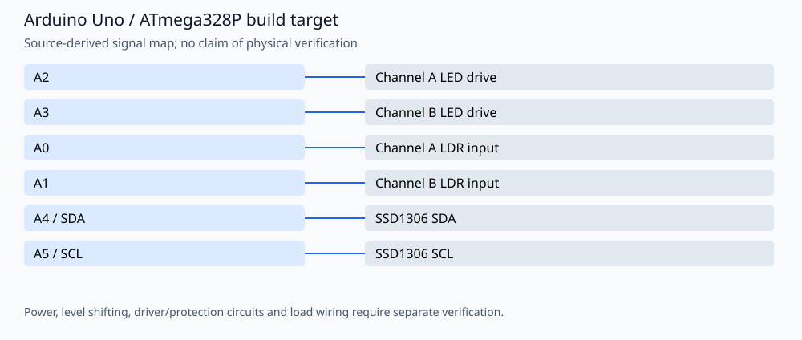

# Dual-channel optical continuity tester

A two-channel LED/LDR continuity check with an SSD1306 OLED and serial diagnostics. Author: **Amir Mobasheraghdam**. Each channel compares an ambient ADC reading with a reading taken while its LED is on; a rise greater than 15 ADC counts is reported as a signal.

## Reproducible build

Install Python 3 and **Arduino CLI 1.3.1**, then run from this repository:

```bash
python3 tools/check_firmware.py --install
```

The helper installs `arduino:avr@1.8.6` and `Adafruit BusIO@1.17.0`, `Adafruit GFX Library@1.12.1`, `Adafruit SSD1306@2.5.13`. It compiles these alternatives
separately in temporary folders, without uploading or rewriting the originals:

- `fiber_tester.ino`
- `arduino/fiber_tester.ino`

Build target: `arduino:avr:uno`. Once dependencies are installed, omit `--install`
to build offline. `--jobs 2` is the default. Set `ARDUINO_CLI` to a CLI executable
or wrapper when using a custom Arduino configuration. Exact build inputs are in
[`tools/firmware.json`](tools/firmware.json). Library dependencies are listed
explicitly and installed with `--no-deps` so transitive updates cannot silently
replace the pinned versions. These are tested build versions, not a claim that
all other core/library versions are incompatible.

The GitHub Actions workflow repeats the firmware checks on pushes and pull
requests. Compilation validates software/toolchain compatibility; it does not
establish hardware safety or successful physical operation.

## Signal assignments



| Signal | Board pin |
| --- | --- |
| Channel A LED drive | A2 |
| Channel B LED drive | A3 |
| Channel A LDR input | A0 |
| Channel B LDR input | A1 |
| SSD1306 SDA | A4 / SDA |
| SSD1306 SCL | A5 / SCL |

## Operation and validation limits

The source selects a 128×64 SSD1306 at **0x3C**. LED current limiting and LDR bias circuits must match the actual components; values and optical performance are not established by the source. This is a relative continuity indication, not a calibrated loss meter. Serial output uses **9600 baud**.

`fiber_tester.ino` and `arduino/fiber_tester.ino` are separate copies; the checks compile both independently. Copy the selected file into a folder named `fiber_tester` for Arduino IDE. `software/requirements.txt` lists optional desktop dependencies but **no desktop application source is committed**; it is not needed for firmware builds. Existing images are retained without treating them as evidence of a new hardware test.

No physical testing, new hardware photographs or measured electrical/optical
performance is claimed. Retain the author attribution and existing license/source
notices when reusing the project.
